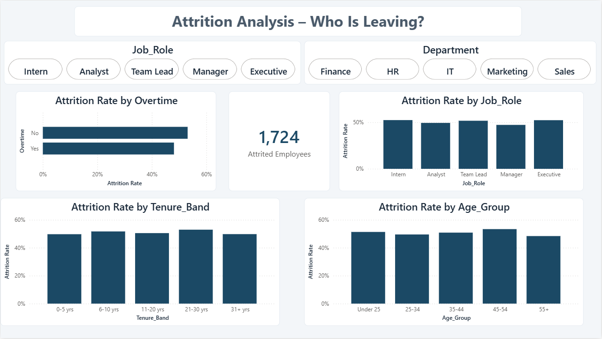
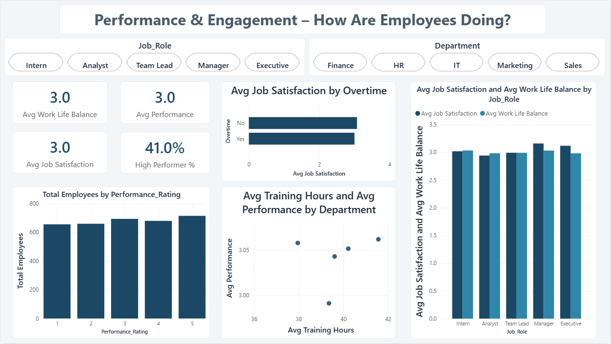
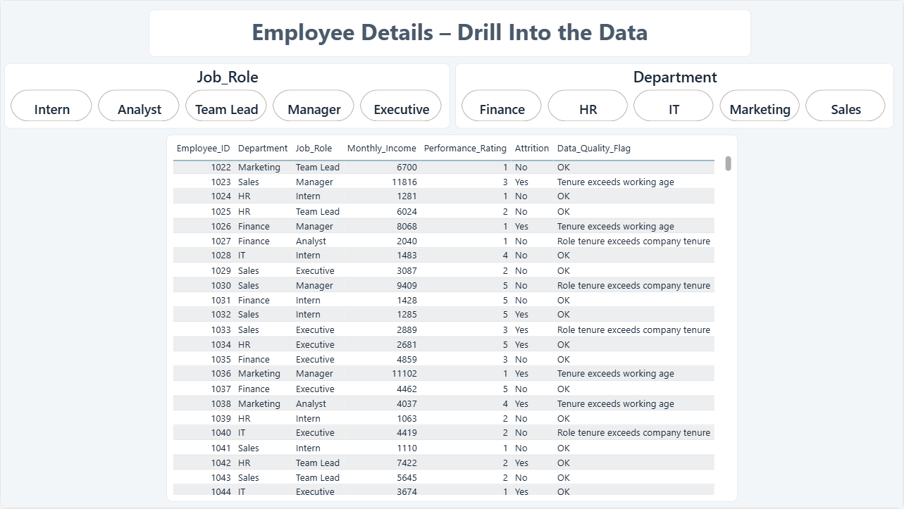

# HR Analytics – Employee Performance & Payroll Dashboard

A Power BI dashboard I built to study employee attrition, payroll, performance and engagement for **3,400 employees**.

> The dataset looks synthetic, so this is a portfolio project and not a real HR study.

## Dashboard Preview

**1. Executive Overview**

**2. Attrition Analysis**

**3. Payroll Analysis**

**4. Performance & Engagement**

**5. Employee Details**

## Key Numbers

| Metric | Value |
|---|---|
| Total employees | 3,400 |
| Employees who left | 1,724 (50.7%) |
| Monthly payroll | 17,426,235 |
| Annual payroll | 209,114,820 |
| Average / median monthly income | 5,125 / 4,326 |
| Overtime share | 48.2% |
| High performers (rating 4 or 5) | 41.0% |

The dataset does not state a currency.

## What I Found

- Attrition is about 50% in every department, role, age group and tenure band.
- Employees without overtime left slightly more (53.1%) than those with overtime (48.1%).
- Average monthly income by role: Manager 9,505, Team Lead 7,663, Executive 3,516, Analyst 3,468, Intern 1,243. Executives earn less than Managers, which is unusual.
- Performance rating, income and job satisfaction show almost no relationship.

## How I Built It

1. Downloaded the HR Employee dataset from Kaggle.
2. Cleaned the data in Power Query: set data types, trimmed text, checked for duplicates and blanks (none found).
3. Added columns for age group, income band, tenure band, annual income and a data-quality flag.
4. Built a star schema: one employee table linked to Department, Job Role and Education tables.
5. Created about 35 DAX measures such as Attrition Rate, Monthly Payroll and High Performer %.
6. Designed five report pages with slicers for Department and Job Role. All visuals cross-filter.

## Files in This Repository

| File / folder | What it contains |
|---|---|
| `HR_Analytics_Dashboard.pbix` | The Power BI report |
| `data/HR_Dataset_raw.csv` | Original Kaggle file |
| `data/HR_Employee_Clean.csv` | Cleaned employee table |
| `data/Dim_Department.csv`, `Dim_JobRole.csv`, `Dim_Education.csv` | Lookup tables |
| `docs/` | Dashboard screenshots |

## How to Open

1. Install **Power BI Desktop** (Windows).
2. Download and open `HR_Analytics_Dashboard.pbix`.
3. If refresh fails, go to **Home → Transform data → Data source settings → Change Source** and select the CSV files from the `data` folder.

## Data Limitations

- There is no date column, so I could not analyse trends over time.
- The data looks synthetic: attrition is about 50% everywhere and the variables are almost unrelated.
- 957 rows have more years at the company than possible for their age, and 608 rows have more years in the current role than at the company. I kept these rows and flagged them instead of deleting them.

## Data Source

[HR Employee Dataset](https://www.kaggle.com/datasets/justinlimyin/hr-employee-dataset) on Kaggle. Please check the licence on that page before reusing the data.

## Author

**Prasanna U N** · [GitHub](https://github.com/Prasanna-Dat)
